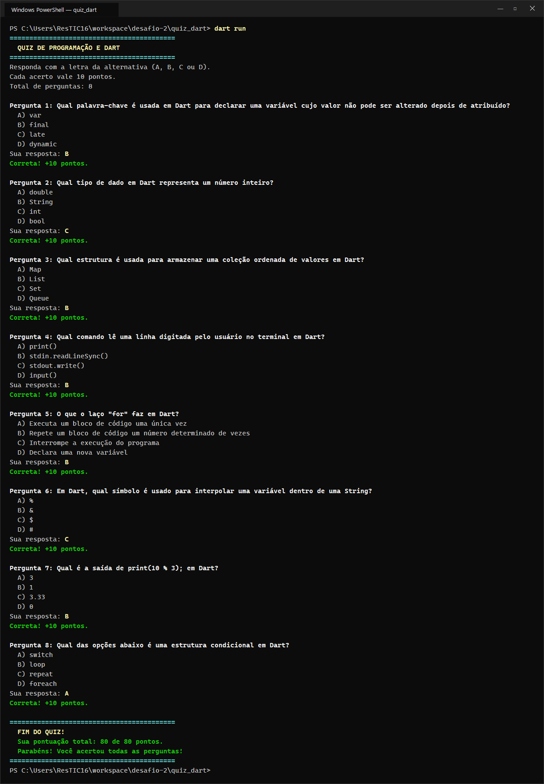

# Quiz de Programação e Dart

Aplicação de console desenvolvida em **Dart** para o **Desafio 2 da Trilha Mobile (Mais Robotic)**: *"Fazendo meu Quiz com Dart"*.

## Descrição do projeto

O programa apresenta um quiz interativo no terminal com **8 perguntas de múltipla escolha** (alternativas **A** a **D**). Para cada questão:

- Exibe o enunciado e as 4 alternativas;
- Lê a resposta do usuário pelo terminal com `stdin.readLineSync()`, aceitando apenas `A`, `B`, `C` ou `D` (maiúscula ou minúscula) e solicitando novamente em caso de entrada vazia ou inválida;
- Soma **10 pontos** por acerto (máximo de **80 pontos**) e exibe feedback imediato indicando se a resposta está correta ou qual era a alternativa certa;
- Ao final, mostra a pontuação total e uma mensagem personalizada conforme o desempenho (`100%`, `>= 60%`, `>= 40%` ou `< 40%`).

## Como rodar

### Pré-requisitos
- [Dart SDK](https://dart.dev/get-dart) instalado e disponível no `PATH` (testado com Dart `3.14.1`).

### Executando o quiz

Clone o repositório, acesse a pasta do projeto e execute com `dart run`:

```bash
git clone https://github.com/diogobrasil/quiz-dart.git
cd quiz-dart
dart pub get
dart run
```

### Outros comandos úteis

```bash
# Verificar análise estática (lints)
dart analyze

# Formatar o código seguindo o padrão oficial do Dart
dart format .
```

## Estrutura de pastas

```text
quiz_dart/
├── bin/
│   └── quiz_dart.dart       # Ponto de entrada: cabeçalho, laço das perguntas, pontuação e resultado final
├── lib/
│   ├── perguntas.dart       # Lista de mapas com as 8 perguntas, alternativas A–D e resposta correta
│   ├── quiz.dart            # Constantes, leitura/validação da resposta e mensagem final por desempenho
│   └── quiz_dart.dart       # Biblioteca padrão gerada pelo template do Dart
├── test/
│   └── quiz_dart_test.dart  # Testes gerados pelo template oficial
├── analysis_options.yaml    # Configuração de regras de análise estática (package:lints)
├── CHANGELOG.md
├── pubspec.lock
├── pubspec.yaml
└── README.md
```

## Tema e perguntas do quiz

**Tema:** Fundamentos de Programação e linguagem Dart.

1. Qual palavra-chave é usada em Dart para declarar uma variável cujo valor não pode ser alterado depois de atribuído?
2. Qual tipo de dado em Dart representa um número inteiro?
3. Qual estrutura é usada para armazenar uma coleção ordenada de valores em Dart?
4. Qual comando lê uma linha digitada pelo usuário no terminal em Dart?
5. O que o laço `"for"` faz em Dart?
6. Em Dart, qual símbolo é usado para interpolar uma variável dentro de uma `String`?
7. Qual é a saída de `print(10 % 3);` em Dart?
8. Qual das opções abaixo é uma estrutura condicional em Dart?

## Exemplo de execução



## Uso de IA

Usei um assistente de IA como apoio na estruturação do projeto e em sugestões de código. O planejamento, o tema, as perguntas, as decisões de implementação e os testes foram feitos por mim.
